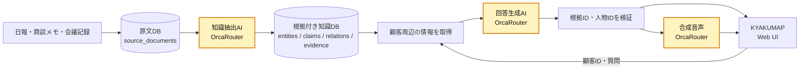

## はじめに

[AI HACK 2026](https://aihackathon.jp/)は、2026年8月8日から16日までの9日間でAIプロダクトを開発するハッカソンです。個人または3名以下のチームで参加でき、使用するモデル・言語・フレームワークは自由。Day1で発表されたテーマは、「本番で通用する次世代のAI Productを作る」でした。

「本番で通用する」とは何か。審査では、プロダクトを次の8項目から評価します。

1. 課題の実在性
2. ビジネス成立性
3. 完成度・デモの説得力
4. AIである必然性
5. 技術的な作り込み
6. LLMコスト
7. セキュリティ
8. 次世代性・独創性

この記事では、私たちがAI HACKで開発した営業準備AI **「KYAKUMAP（キャクマップ）」** を紹介します。

> **顧客情報を、つなげて読む。**

KYAKUMAPは、社内に散らばる記録を顧客・関係者・原文根拠へ対応づけ、次の訪問で確認すべきことを見えるようにするプロダクトです。


## インタビューから見つけた課題

8つの評価項目のうち、私たちが最初に向き合ったのが「課題の実在性」です。作り手の想像だけで課題を決めないために、営業経験者へのユーザーインタビューを行い、顧客訪問の準備が実際にどのように行われているかを聞きました。

インタビューでは、営業担当者によって、商談をまとめるまでの期間に大きな差があるという話が出ました。できる担当者は1〜2ヶ月で一つの商談をまとめる一方、半年から1年経っても「商談中」のまま進まない担当者もいるそうです。

その差を生むものとして挙げられたのが、営業前の**準備**でした。できる担当者は、顧客との会話から専門用語や現場固有の問題を理解し、提案に必要な情報を持ち帰ります。その情報をもとに仮説を立て、相手の反応に応じて切り替えられる提案を3〜4パターン用意して、次の商談へ臨んでいました。

つまり、訪問前に必要なのは商品や案件の情報だけではありません。顧客本人の基本情報、過去のやり取り、意思決定に関わる人物、社内外の人間関係まで集めて初めて、次の訪問の目的や提案の仮説を組み立てられます。

一方で、必要な情報のすべてが日報に残っているわけではありません。日報、商談メモ、会議記録、顧客管理システムに書かれているものもあれば、担当者の頭の中にだけあるもの、まだ誰も確認できていないものもあります。しかも、それらが顧客単位でまとまっていないため、**どこかに記録があるのか、誰かが知っているのか、それともチームの誰もまだ知らないのか**を把握できません。

当初は、AIが営業トークや提案内容を生成するプロダクトも検討していました。しかし、インタビューを進める中で、その前段階にある、

> **顧客について、チームが知っていることと、まだ知らないことの境界を把握できていない**

という課題仮説にたどり着きました。

### 想定する利用者

対象は、複数の担当者が同じ顧客に関わり、日報や商談記録を使って訪問準備をする法人営業チームです。

KYAKUMAPは既存の日報や顧客管理システムを置き換えません。すでに蓄積されている記録を横断し、訪問前に使える形へ変える法人向けの営業支援サービスとして設計しました。

## 作ったもの

KYAKUMAPでは、担当者ごとに埋もれていた記録を、次の訪問で使う判断材料へ変えて表示します。顧客一覧で見せたいのは情報量ではなく、**次に誰と会い、何を確かめるべきか**です。


*散在していた記録を、「新しく分かったこと」と「次に確認すること」へ変換。訪問準備の優先順位が見える顧客一覧です。*

主な機能は次の3つです。

- **関係者マップ**: 担当をまたいだ人物関係と、その根拠になった記録をたどる
- **情報充足度**: 訪問前に確認したい情報を、確認済みと未確認に分ける
- **記録AI**: 顧客ごとにまとめられた社内記録へ、音声またはテキストで質問する

### 関係者マップ

関係者マップで伝えたいのは、人物相関図そのものではありません。**一人の担当者の記録では見えなかったつながりを、チーム全体の訪問準備に再利用できること**です。下の例では、別の訪問記録にあった「元同僚」という情報が現在の顧客へつながり、意思決定を知るための新しい確認先が見つかっています。


*別担当の記録から見つかった人間関係が、現在の商談の判断材料になる。KYAKUMAPが「情報をつなげて読む」と呼んでいる体験です。*

### 情報充足度

営業準備で重要なのは、集まった情報を読むことだけではなく、**自分がまだ何を知らないのかを把握すること**です。KYAKUMAPの情報充足度は、「基本情報」「課題」「キーパーソン」「意思決定」「懸念」の5領域について、会社が確認したいと定めた項目を、根拠付きで確認できたものと未確認のものに分けて表示します。

基準となる項目は、その会社で情報が十分に揃った顧客記録をベンチマークに、営業準備で集めるべき観点として定めます。


*5領域ごとに、根拠付きで確認できている情報の割合を表示します。*

情報充足度を見ると、資料をすべて読み返さなくても、「意思決定者が分からない」「導入時の懸念を聞けていない」といった不足を把握できます。表示する割合は、訪問前に必要な情報のうち、根拠付きで確認できている項目の割合です。

### 記録AI

たとえば、記録AIに「設備の導入を最終的に決めるのは誰ですか？」と質問すると、記録の中に答えがある場合は、根拠となった原文とともに回答します。

答えが見つからなければ、もっともらしい内容を作らず、「現在の記録では分からない」と返します。そのうえで、記録された人物関係をたどり、答えを持っている可能性がある人を確認先候補として提示します。

> **答えを作るのではなく、答えに近づくための確認先を示す。**

記録AIにはマイクとテキストの両方で質問できます。回答の読み上げには人物設定に合わせて選んだ合成音声を使いますが、実在人物本人の発言と誤認されないよう、画面には「〇〇さんの記録AI」「人物設定に合う合成音声」と明示しています。


*顧客ごとに集約した社内記録へ、音声またはテキストで質問できます。*

## AIの役割と設計思想

### なぜAIが必要なのか

扱う入力は、日報、商談メモ、会議記録といった非構造な自然文です。記録ごとに書き方が違い、人物名、事実、人間関係、判断の根拠が一つの決まった項目に収まっているとは限りません。

KYAKUMAPでは、AIを次の2か所で使っています。

1. 原文から人物・事実・関係と、その根拠引用を抽出する
2. 質問に必要な根拠を選び、人物設定に沿った読みやすい回答へ整える

一方で、AIに顧客の本音や購買意向を想像させることは目的にしていません。KYAKUMAPが目指すのは、AIが顧客を作ることではなく、チームがすでに持っている顧客理解へたどり着けるようにすることです。

一般的な文書検索では、答えが見つからなければそこで終わります。KYAKUMAPは、答えがない場合も人物関係から次の確認先を示します。AIを人間の代わりにするのではなく、人間同士が持つ知識へ接続することが、このプロダクトの中核です。

### 自然さと事実性を両立する設計

開発で最も難しかったのは、社内記録へ自然に質問できる使いやすさと、回答の事実性を両立することでした。

LLMへ顧客になりきった自由回答をさせれば、自然な文章は返ってきます。しかし、記録にない本音、購買意向、家族関係までAIが作ってしまえば、営業準備には使えません。

反対に、検索した記録をそのまま並べるだけでは、利用者が複数の記録を読み解く作業が残り、訪問前に必要な情報へすばやくたどり着けません。

そこで、KYAKUMAPでは責務を次のように分けました。

> **知識はDB、表現はLLM、リンクはサーバーで検証する。**

- **DB**: 事実、人物、関係、根拠原文を保持する
- **LLM**: 質問に必要な根拠を選び、人物設定に沿った一人称へ変換する
- **サーバー**: LLMが返した根拠IDと人物IDを検証し、画面へ返す

LLMには事実そのものを作らせず、DBに存在する知識をどのように伝えるかへ役割を限定しました。

## システム構成

KYAKUMAPは、Next.js、PostgreSQL、Drizzle ORMを中心に実装し、知識抽出、回答生成、合成音声にOrcaRouterを利用しています。



処理は、大きく「社内記録を根拠付き知識へ変える処理」と、「その知識を訪問準備に利用する処理」に分かれます。

### 原文とAI抽出結果を分ける

取り込んだ原文は `source_documents`、AIが抽出した人物・事実・関係は `knowledge_*` テーブルへ分け、`evidence_links`で接続します。

抽出時には、LLMが返した根拠引用が本当に原文中に存在するかをコードでも照合し、存在しない引用を持つ候補は保存しません。人物の同一性が曖昧な場合も、既存人物へ無理に統合しない方針にしました。

原文をAI抽出結果で上書きせず、回答から常に元の記録へ戻れる構造にしています。

Notion連携では、原文の取得、OrcaRouterによる知識抽出、知識テーブルへの保存までを一連で実行する取り込みパイプラインを実装しています。

### 根拠のない回答をコード側で拒否する

記録AIは、自由文だけではなく、回答状態と使用したIDを構造化して返します。

```ts
type CustomerAnswer = {
  status: "known" | "partial" | "unknown";
  answer: string;
  evidenceIds: string[];
  suggestedEntityIds: string[];
};
```

LLMへ渡すのは、質問対象となる顧客の周辺から取得した事実、関係、原文根拠、確認先候補だけです。LLMが返した `evidenceIds` と `suggestedEntityIds` は、そのまま信用せず、リクエスト時にサーバーが用意した候補IDの許可リストと照合します。

```ts
const selectedEvidence = result.evidenceIds
  .filter((id) => allowedEvidenceIds.has(id));

const status =
  result.status !== "unknown" && selectedEvidence.length === 0
    ? "unknown"
    : result.status;
```

存在しないIDは破棄し、`known`または`partial`と回答していても、有効な根拠が一件も残らなければ、サーバー側で`unknown`へ降格します。

人物へのリンクURLもLLMには作らせません。検証済みの人物IDからサーバーが組み立てます。流暢な文章が生成されたことではなく、DB上の根拠と接続できたことを表示条件にしました。

## OrcaRouterで、LLMコストとセキュリティを運用に組み込む

[OrcaRouter](https://www.orcarouter.ai/ja)は、複数のLLMと音声モデルをOpenAI互換APIから利用できるAIゲートウェイです。KYAKUMAPでは、次の処理をOrcaRouterへ集約しました。

1. 社内記録から、根拠付きの人物・事実・関係候補を抽出する
2. 記録AIの根拠選択と構造化回答を生成する
3. 記録AIの回答を合成音声にする

### LLMコスト——Auto Routerで質問ごとにモデルを選ぶ

記録AIへの質問も、取り込む社内記録も、内容や複雑さが毎回異なります。そこで、すべての処理を同じモデルへ送るのではなく、内容に応じてモデルを選択するOrcaRouterの`orcarouter/auto`を利用しました。

モデル選定をOrcaRouterへ任せることで、アプリ側に複雑な振り分け処理を持たず、記録AIと知識抽出の両方で、処理内容に応じて品質とコストのバランスを取れる構成にしています。

狙いは、単に安いモデルへ寄せることではありません。簡単な質問に必要以上に高性能なモデルを使わず、判断が難しい質問には必要な性能を割り当てることです。固定質問2問で確認したところ、記録にある趣味を答える質問は`openai/gpt-5-nano-2025-08-07`、記録にない情報を見極めて確認先を示す質問は`google/gemini-2.5-pro`へ振り分けられました。


*同じ記録AIでも、質問の難しさによって選ばれたモデルが異なります。品質とコストの判断をブラックボックスにせず、費用やレイテンシーまで実測で追えるようにしました。公開用にAPIキー名だけぼかしています。*

### セキュリティ——LLMの前後に境界を置く

社内記録の自由記述には、メールアドレスや電話番号などの個人情報が含まれる可能性があります。そこで、KYAKUMAPが使用するAPIキーにOrcaRouterの[Guardrails](https://docs.orcarouter.ai/features/guardrails)を紐付けました。

アプリケーションのデータベース側でも、個人情報を一つの汎用テーブルへ詰め込まない設計にしています。個人に紐づく表示・担当情報は`customer_profiles`、取り込んだ原文は`source_documents`、AIが抽出した知識は`knowledge_*`へ分離しました。用途ごとに保存先を分けることで、閲覧権限や保持・削除の方針も個別に適用しやすくしています。

LLMへの入力にメールアドレス、電話番号、IPアドレス、OrcaRouterのAPIキーが含まれていた場合は、モデルへ送る前にマスクします。クレジットカード番号、SSN、マイナンバー、OpenAI APIキー、AWSアクセスキー、JWTは、モデルを呼び出す前にリクエスト自体をブロックします。検出した文字列をOrcaRouter側へ新たに保存しないよう、マッチ原文のログもOFFにしています。


*社内記録を扱う以上、安全性を利用者や開発者の注意力だけに依存させない。KYAKUMAP用APIキーのすべてのリクエストに、同じ保護方針を強制しています。*


*業務上入りやすい連絡先はマスクして処理を続け、決済・本人確認情報やAPIキーはモデルへ届く前に止める。情報の種類に応じて「隠す」と「送らない」を分けています。*

さらに、アプリケーション側にも次の境界を実装しました。

- OrcaRouterのAPIキーをサーバー側だけで保持し、ブラウザへ渡さない
- LLMへ渡す情報を、質問対象となる顧客の周辺データだけに絞る
- LLMが返した根拠ID・人物IDを、DB由来の許可リストで検証する
- 根拠のない既知回答を表示しない
- 人物リンクをLLMに生成させず、検証済みIDからサーバーで生成する

Guardrailsの有効化前後で同じ入力を使って検証しました。有効化前は`test.user@example.com`がそのままモデルへ渡りましたが、有効化後は`[EMAIL]`へ置換されました。OrcaRouterキーも`[ORCAROUTER_API_KEY]`へ置換され、SSNを含む入力はモデルを呼び出す前にHTTP 400の`guardrail_blocked`で拒否されました。ブロック時のトークン使用量は発生していません。

Guardrailsはアプリケーション側の対策を置き換えるものではありません。顧客周辺データへの入力制限と根拠ID・人物IDの検証を第一の境界、ゲートウェイでのマスク・ブロックを第二の境界として重ねています。

## おわりに

KYAKUMAPが目指したのは、AIに顧客の本音を想像させることではありません。すでに社内にある記録を、訪問前に問いかけられる形へ変え、答えがなければ、知っている可能性がある人へつなぐことです。

> **AIが顧客を作るのではなく、チームが持つ顧客理解へたどり着けるようにする。**

そのために、知識はDB、表現はLLM、リンクはサーバーという責務分離を採用しました。回答を生成するだけでなく、根拠のない回答を表示しないことと、答えられない場合の次の行動まで設計することが、KYAKUMAPの中核です。

## 参考文献

- [AI HACK 2026](https://aihackathon.jp/)
- [OrcaRouter](https://www.orcarouter.ai/ja)
- [OrcaRouter Guardrails](https://docs.orcarouter.ai/features/guardrails)
- [Next.js](https://nextjs.org/)
- [Drizzle ORM](https://orm.drizzle.team/)

## リンク

- プロダクト: https://teamy-sales-prep.vercel.app/
- GitHub: [iineineno03k/KYAKUMAP](https://github.com/iineineno03k/KYAKUMAP)
- 開発イベント: [AI HACK](https://aihackathon.jp/)
- LLM・音声API: [OrcaRouter](https://www.orcarouter.ai/ja)

#AIHACK #OrcaRouter
