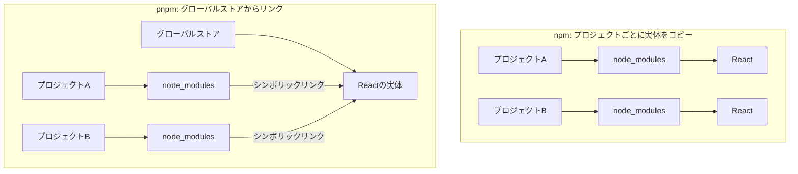

### はじめに

Node.js開発者のみなさん、こんにちは！
プロジェクトで `npm install` を実行したとき、こんなことを感じたことはありませんか？

  * 「インストール、ちょっと遅いな…」
  * 「PCのディスク容量が `node_modules` に圧迫されている…」
  * 「`package.json` に書いていないはずのパッケージが `import` できてしまう…なぜ？」

もし一つでも当てはまったなら、次世代のパッケージマネージャー **`pnpm`** がその悩みを解決してくれるかもしれません。

この記事では、`npm`との違いから`pnpm`の優れた仕組みを解説し、私自身が遭遇した「あるある」なエラーとその解決策までを、一連のストーリーとしてまとめました。

### 1\. pnpmとは？ npmとの根本的な違い

`pnpm`は、`npm`や`yarn`と同じNode.jsのパッケージマネージャーです。最大の特徴は、**効率的な依存関係の管理方法**にあります。

`npm`が抱える課題を、`pnpm`は独創的なアプローチで解決しています。

#### npmの課題：増え続ける`node_modules`とゴースト依存

`npm` (v3以降) は、依存パッケージをプロジェクトの `node_modules` ディレクトリに\*\*平坦（フラット）\*\*に配置します。これにより依存関係のネスト地獄は解消されましたが、新たな課題も生まれました。

1.  **ディスク使用量の増大**: 複数のプロジェクトで同じパッケージ（例: `react`）を使用していても、各プロジェクト内にパッケージの実体がコピーされます。10個のプロジェクトがあれば、ディスク上には10個の`react`が存在することになります。
2.  **ゴースト依存 (Phantom Dependency)**: `package.json`に直接定義していないパッケージにも、依存関係の解決過程で`node_modules`直下に配置されるため、コードからアクセスできてしまいます。これは意図しないライブラリの使用や、環境による動作の不安定さを引き起こす原因となります。

#### pnpmの解決策：グローバルストアとシンボリックリンク

`pnpm`は、この問題をシンボリックリンク（ショートカットのようなもの）を活用して解決します。

1.  **グローバルストアに一元管理**: パッケージは、PC内のグローバルな場所（コンテンツアドレス可能なストア）に**一度だけ**保存されます。
2.  **プロジェクトへはリンクを配置**: プロジェクトの`node_modules`には、パッケージの実体ではなく、グローバルストアにある実体への**シンボリックリンク**が作成されます。

これにより、以下の絶大なメリットが生まれます。

  * **劇的なディスク容量の節約**: 同じパッケージはPC内に一つしか存在しないため、ディスク容量を大幅に節約できます。
  * **超高速なインストール**: 既にパッケージがグローバルストアにあれば、ダウンロードは不要。リンクを作成するだけなので、インストールが非常に高速です。
  * **ゴースト依存の防止**: `package.json`に定義されたパッケージへのリンクしか作成されないため、意図しない依存関係の利用を防ぎ、より信頼性の高いプロジェクトを構築できます。

<!-- end list -->



### 2\. pnpmで遭遇する「あるある」エラーと解決策

`pnpm`を使い始めると、いくつかの特有のエラーに遭遇することがあります。ここでは、私が実際に体験したエラーと、その解決までの道のりを紹介します。

#### ケース1: `pnpm: command not found`

意気揚々と `pnpm install` を実行したら、まずこのエラーに遭遇しました。

```bash
$ pnpm install
bash: pnpm: command not found
```

これは単純に、`pnpm`がPCにインストールされていないか、インストールされていてもPATHが通っていないことが原因です。

**解決策：`npm`を使ってグローバルにインストールする**
`npm`はNode.jsと一緒についてくるので、これを使って`pnpm`をインストールするのが一番手軽です。

```bash
npm install -g pnpm
```

インストール後、**ターミナルを一度閉じて、新しく開く**ことを忘れないでください。その後、バージョンが表示されれば成功です。

```bash
$ pnpm -v
10.8.1 # (例)
```

#### ケース2: `ERR_PNPM_UNSUPPORTED_ENGINE`

無事に`pnpm`をインストールでき、`pnpm install`を再度実行。すると今度は別のエラーが。

```bash
 ERR_PNPM_UNSUPPORTED_ENGINE  Unsupported environment (bad pnpm and/or Node.js version)

Your Node version is incompatible with "@stoplight/spectral-formats@1.8.2".

Expected version: ^16.20 || ^18.18 || >= 20.17
Got: v20.11.0

This is happening because the package's manifest has an engines.node field specified.
To fix this issue, install the required Node version.
```

このエラーメッセージは非常に親切です。

  * **原因**: プロジェクトが依存するパッケージ (`@stoplight/spectral-formats`) が、あなたのNode.jsバージョン (`v20.11.0`) をサポートしていない。
  * **要件**: そのパッケージはNode.js `v20.17.0` 以上を要求している。

**解決策：Node.jsのバージョンを上げる**
この問題を解決するには、**Node.jsのバージョン管理ツール**を導入するのがベストです。ここでは代表的な `nvm` (Node Version Manager) を使います。

1.  **`nvm`で新しいNode.jsをインストール**

    ```bash
    # nvmが未導入の場合は先にインストールしてください
    nvm install 20.17.1 # 要求されているバージョン以上をインストール
    ```

2.  **使用するバージョンを切り替え**

    ```bash
    nvm use 20.17.1
    ```

3.  **バージョンを確認**

    ```bash
    $ node -v
    v20.17.1 # 新しいバージョンが表示される
    ```

この状態で再度 `pnpm install` を実行すれば、エラーは解消されます。

#### ケース3: 「Nodeバージョンを上げたら、またpnpmが消えた！？」

Node.jsのバージョンを切り替えた後、再び `pnpm` を実行すると、なんと `command not found` エラーが再発しました。

**原因と解決策：グローバルパッケージはNode.jsバージョンに紐づく**
これは `nvm` の重要な仕様が関係しています。`npm install -g` でインストールしたパッケージは、システム全体ではなく、**現在有効なNode.jsバージョンに紐づいて**保存されます。

`nvm` でNode.jsのバージョンを切り替えることは、工具一式が入った「道具箱」を丸ごと入れ替えるようなものです。古い道具箱 (`v20.11.0`) に入れていた `pnpm` という工具は、新しい空の道具箱 (`v20.17.1`) には入っていません。

したがって、解決策はシンプルです。

**新しいNode.jsバージョン上でもう一度`pnpm`をインストールする**

```bash
# Node v20.17.1 を有効にした状態で
npm install -g pnpm
```

これで、新しいバージョンのNode.js環境でも `pnpm` が使えるようになります。

### まとめ：pnpmで快適な開発環境を

`pnpm` は、その優れた仕組みによって、私たちの開発体験をより速く、より効率的にしてくれます。

  * **ディスク容量の節約**
  * **高速なインストール**
  * **厳格な依存関係管理**

最初は少し戸惑うかもしれませんが、今回紹介したようなエラーとその背景を理解すれば、もう怖くありません。

チームで開発する際は、プロジェクトルートに推奨Node.jsバージョンを記述した `.nvmrc` ファイルを配置したり、Node.js本体に統合されつつある `Corepack` を利用したりすることで、さらに環境の統一が容易になります。

`npm`の課題に悩んでいる方は、ぜひ次のプロジェクトから`pnpm`の導入を検討してみてはいかがでしょうか。

### 参考文献

  * [pnpm 公式サイト](https://pnpm.io/)
  * [pnpm | Motivation](https://pnpm.io/motivation)
  * [nvm (Node Version Manager) | GitHub](https://github.com/nvm-sh/nvm)
  * [Node.js Docs | Corepack](https://nodejs.org/api/corepack.html)
