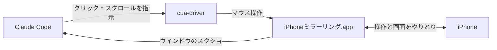

## スマホの設定、めんどくない？

スマホに黙っててほしい時間ってある。電話も通知も、その間だけは一切鳴らないでほしい。iPhoneなら集中モードで止められる。

ところが設定画面を開くと、「通知を許可する人」「着信」「繰り返しの着信」「集中モード状況の共有」……と項目がやたら多い。どれをいじれば止まるのか、毎回ググり直すことになる。正直めんどい。

じゃあAIにやらせればよくない？　と思って、Claude Codeに「設定難しいからやってほしい」と投げた。

最初の返事は「Macからは操作できないので、手順を案内しますね」。いや、手順じゃなくてやってほしいんだよな。

「おまえ操作できないの？」と返したら、Claude CodeはMacの中を調べ始めて、標準アプリの「iPhoneミラーリング」を見つけてきた。そこからは最後まで全部やり切った。

自分がやったのは、最初の接続の許可と、最後に電話をかけて鳴らないのを確かめたことだけだ。

## Claude Codeがやったこと

Macに映ったiPhoneの画面を見ながら、Claude Codeが設定アプリをポチポチ操作していく。

まず集中モードを1個新しく作る。


通知を許可する連絡先とアプリは、どっちもゼロ。


着信は「通知される連絡先のみ」にして、その連絡先には誰も入れない。地味に効いているのが「繰り返しの着信を許可」のオフ。これがオンだと、3分以内に2回かけてきた人の電話は鳴る。知らないと普通に見落とすやつだ。


で、もう1つの落とし穴がLINE通話。LINEには「iPhoneの基本通話と統合」という設定があって、オンだとLINE通話は普通の電話扱いになる。Claude CodeはLINEアプリまで開いて、ここもオフにした。これでLINE通話はただの通知になり、集中モードでちゃんと止まる。


ついでに、相手のメッセージアプリに「通知を停止中」と出る「集中モード状況の共有」も、このフィットネスだけ切ってあった。

最後に電話とLINE通話を実際にかけてみて、どっちも鳴らない。これで完了。

## どうやって動いてるのか



核になるのは2つ。

- **iPhoneミラーリング**：macOS Sequoiaから入った標準アプリ。iPhoneの画面がMacのウインドウに出てきて、Macのマウスで触れる
- **cua-driver**：AIエージェントがMacのアプリを操作するためのCLI。`cua-driver call click '{...}'` みたいに呼ぶ

自分の環境はmacOS 15.5、cua-driver 0.30.3。iPhoneミラーリングはmacOS 15以降とiOS 18以降、同じApple Accountなどが条件になる（細かい条件はAppleのページ）。使ってる間はiPhone本体をロックして置いておくこと。途中でiPhoneを触ったら、ミラーリングが切れた。

## ハマったところ

### ボタンが「見えない」

cua-driverは普段、macOSのアクセシビリティツリーを読んで操作する。要は「この画面に『保存』ボタンがある」という部品の一覧で、これがあればボタンを名指しで押せる。

ところがiPhoneミラーリングのウインドウでこれを取ると、空っぽで返ってくる。

```text
"degraded_reason": "ax_window_unresolved: ... The tree is returned EMPTY on purpose"
"element_count": 0
```

たぶんiPhoneの画面は映像として流れてきているだけで、Macからはボタンとして見えないんだと思う。

なのでClaude Codeは、スクショを撮って、見て、「ここ」と座標を決めて押す。押したらまたスクショを撮って、画面が変わったか確かめる。人間が目で見てタップするのを、1回ずつ律儀にやっている感じだ。

1回分のコマンドはこれ。

```bash
# PID と WIN は `cua-driver call list_windows '{}'` で調べたiPhoneミラーリングのウインドウ
# S は `cua-driver call start_session '{"session":"任意の名前"}'` で始めたセッション名
SHOTS=$(mktemp -d)   # スクショはリポジトリの外に置く

osascript -e 'tell application "iPhone Mirroring" to activate'   # 前面に出す
cua-driver call get_window_state "{\"pid\":$PID,\"window_id\":$WIN,\"session\":\"$S\"}" > /dev/null
cua-driver call click "{\"pid\":$PID,\"window_id\":$WIN,\"x\":120,\"y\":345,\"delivery_mode\":\"foreground\",\"session\":\"$S\"}"
screencapture -l "$WIN" -o "$SHOTS/after.png"   # 次に押す場所を決めるためのスクショ
```

この形になるまでに2回つまずいた。

まず、「設定」を押したつもりが全然違うアプリが開いた。iPhoneミラーリングのウインドウが別のデスクトップにいて、クリックがその位置にある別のものに当たっていたらしい。毎回 `activate` で前面に出すようにしたら直った。

次に、作業を中断して再開したら、クリックが `screenshot_context_missing` で全部弾かれた。cua-driverは、そのセッションで一度 `get_window_state` を呼んでおかないと座標クリックを受け付けない。誤クリック防止だと思う。上のコマンドで毎回呼んでいるのはこのためだ。

### 文字が打てない

設定アプリの検索欄に「集中モード」と打って一発で飛ぼうとしたら、こうなった。

| 試したこと | 結果 |
|---|---|
| `type_text` で「集中モード」 | 「ああああ」になる |
| `type_text` で「LINE」 | これも「ああああ」 |
| `hotkey` で cmd+v | 「v」が入る |
| `invoke_menu` で 編集→ペースト | 「メニューが無効」で拒否 |

全滅。

結局、検索欄をタップしただけで出てくる「提案」と「最近の項目」を使った。今回は行きたい項目がたまたまここに出ていたので、文字を打たずに飛べた。出てこなければ、一覧をスクロールして探すしかない。


LINEも、ホーム画面の検索の提案に出ていたアイコンから開いた。

### スクロールが効かない

LINEの「通話」設定は、設定画面のかなり下にある。ここまで行くのにも手こずった。

| 試したこと | 結果 |
|---|---|
| `drag`（スワイプのつもり） | 動かない |
| `scroll` を行単位で | 動かない |
| `scroll` を `"by":"page"` で | 動いた |

ページ単位でも1回でちょっとしか進まないので、何回か回して下まで送った。

### スクショに全部写る

見ながら操作する以上、通った画面は全部スクショに残る。今回もLINEのトーク一覧やカレンダーの予定がばっちり写っていた。スクショはリポジトリの外の一時フォルダに置いて、終わったらまとめて消しておく。

## まとめ

ボタンは見えない、文字は打てない、スクロールも効かない。クセはかなり強い。

それでも「設定難しいからやって」の一言で、集中モードからLINEの奥の設定まで全部終わった。自分がやったのは最初の許可と最後の確認だけ。

スマホの設定で詰まったら、手順を聞く前に「やって」と頼んでみるといい。断られたら「おまえ操作できないの？」と聞き返す。

## 参考文献

- [iPhoneミラーリング：MacでiPhoneを使う - Apple サポート](https://support.apple.com/ja-jp/120421)
- [iPhoneの集中モードをオンにする/スケジュールする - Apple サポート](https://support.apple.com/ja-jp/guide/iphone/iph5c3f5b77b/ios)
- [Cua Driver | Cua docs](https://cua.ai/docs/cua-driver)
- [Quickstart | Cua docs](https://cua.ai/docs/cua-driver/quickstart)
